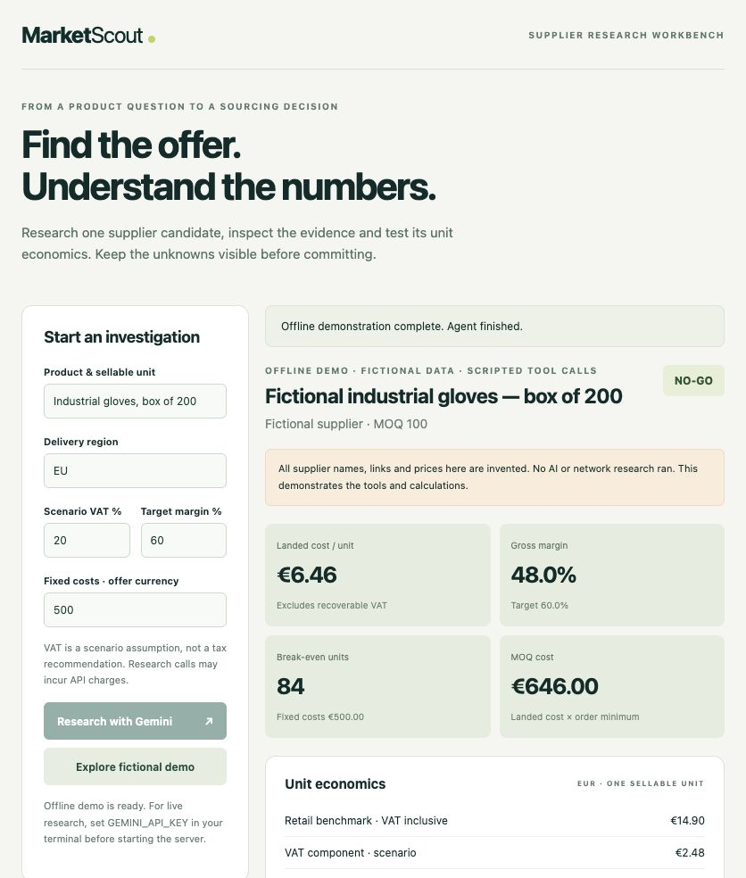
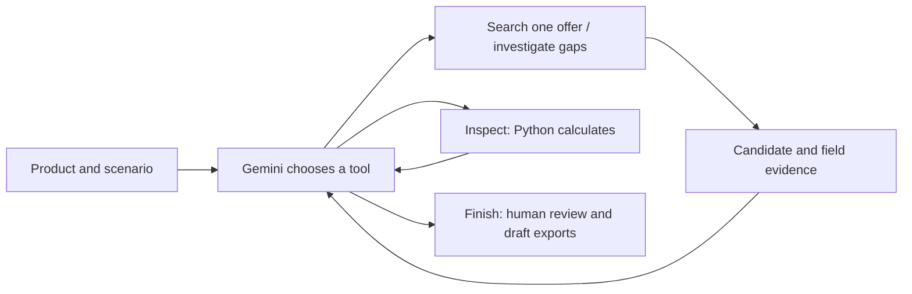

# MarketScout

A supplier-research workbench that turns a product question into an inspectable candidate offer, evidence review, margin scenario and supplier inquiry draft.

**Status:** the dashboard and offline workflow run locally. Gemini search and tool-calling adapters are implemented and tested with mocked responses. **A real-key live run has not yet been verified.** The offline demo uses fictional data and scripted tool calls, not a live AI agent.



## Try it

Python **3.10+**. The offline demo needs only Python's standard library:

```bash
python3 dashboard.py
```

Open **http://127.0.0.1:8766/** and select **Explore fictional demo**. The example first has missing shipping, identifies that gap, then supplies a fictional shipping figure and recalculates. Change the scenario assumptions and rerun to compare outcomes.

For live research, install the SDK in a virtual environment:

```bash
python3 -m venv .venv
source .venv/bin/activate
python -m pip install -r requirements.txt
# Set GEMINI_API_KEY securely in your terminal environment, then:
python dashboard.py
```

The key stays on the server; do not put it in browser fields, committed files or screenshots. Live requests send your product query, destination, scenario assumptions and candidate research to Google's API and may incur charges. `MARKETSCOUT_MODEL` overrides the default `gemini-3.6-flash`; the chosen model must support search grounding, structured output and function calling. Each provider request has a 45-second timeout and one attempt.

## How the agent works



The live agent chooses between `research_offer`, `inspect_offer` and `finish_review`. It can investigate missing information, inspect the resulting economics and stop when further research is unlikely to help. Execution is limited to **6 model turns, 8 executed tools and 2 research requests**. A search request may itself involve multiple provider-managed web searches; these limits are not a monetary spending cap.

The browser shows executed tool calls with their inputs and results. It never displays a fabricated agent conversation. The offline mode uses the same executor with a scripted planner and fictional researcher. No tool can email a supplier, buy goods or approve a purchase.

## Calculation rules

- Retail benchmark is VAT inclusive. Net revenue = retail / (1 + scenario VAT rate).
- Landed cost = wholesale + shipping + duty, per identical sellable unit and currency, excluding recoverable VAT.
- Gross profit = net revenue − landed cost. Gross margin = gross profit / net revenue.
- Break-even units = ceiling(fixed costs / positive unit gross profit); unavailable if unit profit is zero or negative.
- MOQ cost = landed cost × minimum order quantity. This is not a complete cash-flow forecast.
- Missing prices, shipping, duty or MOQ produce **INCOMPLETE**, never an assumed zero. In live extraction, financial inputs without a field-specific citation also remain unknown.
- **GO** means only that the unrounded scenario margin meets the selected threshold. It is not supplier validation or purchase approval.

VAT is user-supplied, not a determination of the applicable tax regime. Costs omit platform fees, returns, storage, financing and other operating costs. There is no FX conversion. A citation is a research lead, not independent verification: check currency, pack size, tax basis, delivery terms, source dates and quote validity yourself.

## Outputs

The dashboard downloads:

| File | Contents |
| --- | --- |
| `catalog_entry.csv` | Candidate, currency, prices, MOQ and scenario margin status |
| `supplier_rfq.txt` | Unsent inquiry draft asking the supplier to confirm terms |
| `investigation.json` | Full candidate, assumptions, evidence, executed trace and review status |

The existing command-line workflow also works:

```bash
python3 market_scout.py "industrial gloves" --dry-run --fixed-costs 500 --output-dir outputs
```

It writes `catalog_entry.csv`, `supplier_rfq.txt` and `research.json`. Without `--dry-run`, the CLI performs one grounded extraction; use the dashboard for the bounded investigation loop. Example files in `outputs/` are fictional.

**Compatibility change:** catalog columns now use `currency`, `est_wholesale` and `target_retail` rather than incorrectly labelling every currency EUR. Shipping and duty are now included explicitly; the previous automatic 15% freight uplift is removed. Existing sample margins therefore change.

## Checks and boundaries

```bash
python -m unittest discover -s tests -v
```

With the pinned SDK installed, **14 checks** cover VAT, shipping, missing fields, exact-threshold decisions, loss-making offers, break-even rounding, CSV safety, tool budgets, mocked live SDK responses, local API validation and downloads. The two SDK tests skip when the optional dependency is absent. Tests make no real supplier searches or paid API requests.

This is a **local, single-user prototype**, bound to `127.0.0.1`, with same-origin checks and a single active investigation. It is not ready for public hosting. Runs are held in memory (up to 20), disappear on restart, and can be downloaded for your records. Evidence is model-reported and may be wrong; prompt-injection instructions are rejected by policy, but this is not a proof of immunity. There are no live procurement/ERP integrations, automated communications or tax-compliance guarantees.

| File | Responsibility |
| --- | --- |
| `market_scout.py` | Validation, deterministic economics, draft exports and original CLI |
| `scout_agent.py` | Grounded research adapter, bounded tool executor and agent loop |
| `dashboard.py` | Local server, validation, in-memory runs and downloads |
| `static/` | Browser interface; no API keys or model calls |
| `tests/` | Offline calculation, agent and HTTP checks |

The next validation step is one real-key run against a product with publicly available wholesale, delivery and retail evidence. Inspect every source before presenting it as a verified sourcing result. Live evidence should precede any further feature expansion.
